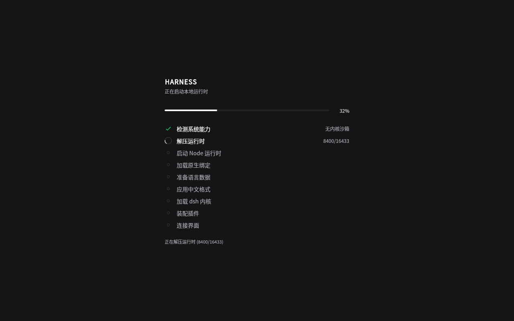

# DSH Android

**把 DeepSeek Harness 完整搬到 Android** —— 内嵌 libnode 24 当宿主进程，界面用 Flutter 原生控件重绘，零 WebView。

插件**一行不改**：宿主接管插件的 `require` 与 `ctx.slots`，把 React 树转成 IR，再由 Flutter 把 IR 画成原生控件。这是为了在移动端拿到真正的滚动性能、输入法、剪贴板和深色主题，而不是塞一个浏览器内核进 APK。


首次安装需要解压 16000 多个运行时文件（约 40 秒），这期间显示九步清单，每一步完成即打勾：



> 项目当前处于**可用但未完整验证**的状态：宿主层已有真机报告支撑，界面层仍在收尾。逐项证据见 [docs/05-limits.md](docs/05-limits.md)。

---

## 目录

- [这是什么](#这是什么)
- [安装](#安装)
- [首次启动](#首次启动)
- [架构](#架构)
- [项目结构](#项目结构)
- [从源码构建](#从源码构建)
- [测试](#测试)
- [平台支持与已知限制](#平台支持与已知限制)
- [常见问题](#常见问题)
- [参与贡献](#参与贡献)
- [许可证](#许可证)

---

## 这是什么

Android 上没有现成的 Node.js，而 DSH 的宿主是一整个 Node 进程。这个项目做了三件事：

1. **把 libnode 编译成 Android 可加载的 `.so`**，用 JNI 起一个前台服务进程跑真正的 Node 24.20.0；
2. **把 dsh 的运行时闭包裁好打进 APK**，首启动解压到应用私有目录，纯 JS 不改源码；
3. **在 Flutter 里重画 DSH 的界面**，通过 unix socket + NDJSON 和宿主通信。

产物只有一个 APK，装完就能离线跑起来（模型请求仍需联网，走你自己配的服务商）。

### 与 WebView 方案的区别

| | WebView 套壳 | 本项目 |
|---|---|---|
| 界面渲染 | 浏览器内核 | Flutter 原生 Widget |
| 滚动 / 输入法 / 剪贴板 | 取决于内核版本 | 系统原生行为 |
| APK 体积 | 小 | 大（带 libnode + Flutter 引擎，约 63 MB） |
| 插件兼容 | 完全兼容 | 需经 IR 桥，少数依赖 DOM 的插件降级 |

代价是体积和渲染层的适配工作量。收益是界面不再像"手机上打开的网页"。

---

## 安装

从 [Releases](https://github.com/TangkunNull/dsh-android/releases) 下载对应包，或直接构建（见[从源码构建](#从源码构建)）。

> 免费用，也可以商用 —— 但改过的代码必须开源。**要闭源商用请先看[许可证](#许可证)**，需单独取得授权。

| 产物 | 包名 | 用途 | 体积 |
|---|---|---|---|
| `dsh-android-<版本>-release.apk` | `ai.dsh.app` | **主应用**，桌面名称为 `DSH Android` | 约 63 MB |
| `dsh-probe-<版本>-release.apk` | `ai.dsh.probe` | 诊断壳：点「生成报告」导出环境与启动日志 | 约 54 MB |

- **系统要求**：Android 9（API 28）及以上，**仅 arm64**（`libnode.so` 只有 arm64 构建，没有 32 位或 x86 包）。
- 两个包名不同，可以同时安装、互不覆盖。「先装探针看后端是否正常，再装主应用看界面」是推荐的排查顺序。
- 侧载安装时系统会提示「未经应用市场检测」，选择继续安装即可。

> 两个包的 `versionName` / `versionCode` 始终一致，构建脚本会强制比对，避免"报告写的是新版、装的是旧版"这类对不上的情况。

---

## 首次启动

| 阶段 | 做什么 | 大致耗时 |
|---|---|---|
| 解压运行时 | 16000+ 文件从 APK 的 `assets/runtime.zip` 解到私有目录 | 30–45 秒（视存储速度） |
| 起 Node | JNI 加载 `libnode.so`，`harness.js` 引导 | 1–3 秒 |
| 装配插件 | cordis 逐行加载 130 余个插件 | 8–15 秒（受 CPU 影响） |
| 连接界面 | unix socket + token 握手，首帧数据到达 | < 1 秒 |

首次启动黑屏或停在加载页是正常的，**不要中途杀掉进程** —— 解压中断会留下半套运行时，下次启动会重新解。之后的启动只需一两秒，会显示轻量启动页。

`needsUnpack` 由原生侧根据运行时的 `buildId` 判定，不是靠日志时序猜的；APK 升级后 `buildId` 变化会自动重新解压。

---

## 架构

```
Flutter UI
   │  unix socket + NDJSON（token 握手）
   ▼
:harness 进程（libnode 24.20.0）
   ├─ 同进程直连 ──> dsh gateway（POST /api/<ns>/<method> + WS /api/remote.mux）
   └─ ctx.sandbox ──> landlock runner（nativeLibraryDir）
```

Flutter 到 gateway 只有**两跳**：socket 到 `:harness`，然后同进程直接调 gateway。没有 `127.0.0.1:7020` 这种环回 HTTP（见 `impl/src/host/protocol/transport-inproc.mjs`）。

### 分层

| 层 | 位置 | 职责 |
|---|---|---|
| 界面 | `impl/app/`（Dart） | 把 IR 画成 Widget；改色、改字号、改布局都在这一层 |
| 渲染引擎 | `impl/src/`（mjs） | React 19 reconciler → IR 树；自写 CSS 级联、选择器、影子 DOM |
| 宿主包 | `impl/src/host/` | 协议编解码、HTTP/WS transport、会话链路、插件装载入口 |
| 宿主进程 | `impl/android/harness/`（Kotlin） | 前台服务、解包、环境变量、日志；JNI 起 Node |
| 原生运行时 | `impl/android/runtime/` | libnode 桥、`libnode.so`、`libdsh_pty.so`、沙箱 runner |

**依赖方向是单向的**：界面不认识协议细节，渲染引擎不认识 Flutter，宿主包不认识 Android API。跨层改动必须先改接口。

---

## 项目结构

```
.
├── docs/                     设计文档：总览、运行时、协议、沙箱、构建、限制、UI、兼容
│   ├── adr/                  架构决策记录
│   ├── evidence/             门禁证据（插件兼容矩阵等）
│   └── notes/                细节笔记（Node 版本、接线核验、测试策略）
├── impl/
│   ├── src/                  渲染引擎与宿主包（42 个 .mjs，其中宿主包 5 个）
│   ├── android/
│   │   ├── runtime/          libnode JNI 桥、预编译 .so、头文件
│   │   ├── harness/          :harness 前台服务（Kotlin）
│   │   └── app/              探针壳（ai.dsh.probe）
│   ├── app/                  Flutter 主应用（ai.dsh.app）
│   ├── protocol/             协议声明的唯一真相（只有 .d.ts，无实现）
│   ├── tools/                构建、打包、回归、诊断脚本
│   ├── fixtures/             测试夹具（真实协议样本、插件样本）
│   └── vendor/               上游快照与预编译件（只读）
├── deliverables/
│   └── libnode-rebuild/      重编 libnode 的脚本（换 so 或自编 full-icu 时用）
└── out/                      本地产物（APK 不进 git，清单见 RELEASE.md）
```

---

## 从源码构建

### 前置

| 依赖 | 版本 | 说明 |
|---|---|---|
| JDK | 17 | Gradle 7.6.3 不支持 20（报错是 `Unsupported class file major version 64`，与 JDK 无关） |
| Android SDK | API 35 + build-tools 35.0.0 | `aapt2` 需在 `gradle.properties` 里覆盖 |
| NDK | 27.2.12479018 | `llvm-strip` / `llvm-readelf` 来自这里 |
| Flutter | 3.x | 临时置 `PATH`，脚本里写死 `/opt/flutter/bin/flutter` |
| Node.js | **24.x** | 打包脚本要用 Node 24 的 `zstd`，22 没有 |

`libnode.so` 已在仓库内（62 MB，`--strip-unneeded` 后）。只有换 Node 版本时才需要重编，见 `deliverables/libnode-rebuild/`（40 分钟 / 4 核）。

### 命令

```bash
# 运行时闭包（产物不进 git）
node impl/tools/pack-runtime.mjs --verify

# 探针包 release → out/dsh-probe-<版本>-release.apk
bash impl/tools/build_apk.sh

# 探针包 debug（要逐行断点时用）→ out/dsh-probe-debug.apk
bash impl/tools/build_apk.sh probe debug

# 主应用 → out/dsh-android-debug.apk
bash impl/tools/build_apk.sh flutter

# 主应用 release → out/dsh-android-<版本>-release.apk
bash impl/tools/build_apk.sh flutter release
```

版本号取 `impl/app/pubspec.yaml` 的 `version`，构建时与探针的 `versionName` 比对，不一致直接失败。

构建脚本内置的门禁（任一不满足即失败）：

- `libnode.so` 的 `napi_*` 导出必须是 145 个 —— 防止误用 `--strip-all` 把 `.dynsym` 剥掉
- 随包的 5 个 `.so` 的 `LOAD` 段必须 16 KB 对齐（`0x4000`）
- `librg.so` 必须静态链接、无 `PT_INTERP`
- `assets/runtime.zip` 必须是 `Stored`（不二次压缩）
- `runtime.zip` 必须与 `runtime-manifest.json` 一致
- manifest 必须声明 `foregroundServiceType` + `FOREGROUND_SERVICE_SPECIAL_USE`

### 替换应用图标

当前是占位图标（深色底 + 白色 D）。替换时按密度改这两组文件，不用动代码：

```
impl/app/android/app/src/main/res/
├── mipmap-mdpi/ic_launcher.png        48×48    ic_launcher_foreground.png   108×108
├── mipmap-hdpi/ic_launcher.png        72×72                                 162×162
├── mipmap-xhdpi/ic_launcher.png       96×96                                 216×216
├── mipmap-xxhdpi/ic_launcher.png     144×144                                324×324
├── mipmap-xxxhdpi/ic_launcher.png    192×192                                432×432
└── mipmap-anydpi-v26/ic_launcher.xml  自适应图标（背景色在 values/colors.xml）
```

自适应图标的前景层只需保证图形落在 108dp 画布**中央 66dp 的安全区**内，外圈会被各家启动器裁掉。

---

## 测试

```bash
cd impl && npm test              # Node 侧：283 条
cd impl/app && flutter test      # Flutter 侧：197 条
node impl/tools/regress.mjs      # 28 个真实插件分级：A=20 / B=6 / C=0
node impl/tools/probe-suite.mjs  # gateway 端点 14 项
```

「A」= 完整渲染，「B」= 降级可用，「C」= 不兼容。分级结果与失败原因在 `docs/evidence/`。

---

## 平台支持与已知限制

| 项 | 状态 |
|---|---|
| 构建可安装 APK | ✅ 两个模块，release + debug |
| libnode 起 Node | ✅ 编译层与 bionic 层各 10/10，JNI 3/3 |
| dsh 本体进包并自检 | ✅ `typertGateway` / `connection` / `fs` / `shell` 均 ok |
| gateway 端点 | ✅ 14/14 |
| 插件渲染 | ✅ 28 个真实插件，A=20 |
| 前台服务类型合规 | ✅ targetSdk 35，`specialUse` + 对应权限 |
| 中文日期显示 | ✅ 运行时补丁，不重编 libnode（`impl/tools/intl-zh/`） |
| 界面层真机验证 | 🟡 代码与单测就绪，尚未在设备上跑完整流程 |
| OS 级沙箱 | 🟡 代码就绪（39 条测试），设备无 landlock 时按设计降级为 `none` |
| 16 KB 页设备 | ❌ Flutter 3.0 的 `libflutter.so` 仍为 4 KB 对齐，引擎拒绝加载；启动时拦下并说明 |
| 非中文 locale / 拼音排序 | ❌ 内置 small-icu（只有 en）。中文日期由补丁覆盖，其余需自编 full-icu |

「✅」= 有命令或测试可复现；「🟡」= 依赖真机或外部凭据，尚无真机结论。

---

## 常见问题

**装完打开黑屏很久？**
首次启动在解包 16000+ 个文件。看加载页的进度条是否在走；若长时间不动，装探针版导出报告，能看到卡在哪一步。

**为什么 APK 这么大？**
`libnode.so` 62 MB（V8 本体）+ Flutter 引擎 + 运行时闭包。V8 无法按需裁剪到"只跑 DSH"的程度。

**能装到模拟器上吗？**
不能，只有 arm64 构建。x86_64 模拟器会安装失败或加载 `.so` 时报错。

**模型怎么配？**
设置页填 baseURL / model（可选 key），重启应用生效。请求直接发给你配置的服务商，本项目不代理、不内置任何凭据。

**中文日期为什么是补丁而不是完整 ICU？**
重编 full-icu 的 libnode 需要约 26 小时 / 4 核。运行时补丁覆盖了最高频的日期时间场景，代价是几十 KB 的 JS。

---

## 参与贡献

- 提 Issue 前先看 [docs/05-limits.md](docs/05-limits.md)，已知不支持的能力列在里面。
- 报告真机问题时请用探针版导出报告，它会带上运行时版本、`buildId`、插件装配统计和错误行。
- 改渲染层前读 `impl/README.md` 的坑表（15 条，每条对应一个仍在跑的回归用例）。
- 提交前跑通 `npm test`、`flutter test` 与 `build_apk.sh` 的门禁。
- 提交 PR 即表示你同意[贡献者授权条款](COMMERCIAL.md#六贡献者的再许可授权)：你的代码按 AGPL-3.0 发布，并允许作者按商业条款再许可。没有这一条，双轨授权就断了。

## 许可证

本项目以 **[GNU Affero 通用公共许可证 v3.0（AGPL-3.0）](LICENSE)** 发布，另有商业授权可选。

一句话：**拿去用、改、卖都行，但改完必须开源 —— 包括只提供网络服务、不发布安装包的情况。**

| 你想做的事 | 需要做什么 |
|---|---|
| 自己用、学习、研究、非营利 | 什么都不用做 |
| 把改过的版本发给别人 / 卖给别人 | 提供完整可构建源码，并以 AGPL-3.0 授权 |
| 部署成网络服务（SaaS、云手机、远程桌面） | 向使用者提供源码获取方式（第 13 条） |
| 闭源商用 | 先取得[商业授权](COMMERCIAL.md) |

这是 OSI 认可的开源许可证，也是 copyleft 里最强的一档：GPL 只管「分发」，AGPL 把「通过网络提供服务」也算作分发 —— 所以「改一改架在服务器上收钱、却不公开源码」这条路在这里走不通。

换个角度说：**这个许可证不挡人赚钱，只挡人藏代码。** 想闭源商用，只能来谈授权。

- 法律文本：[LICENSE](LICENSE)（661 行，与 gnu.org 官方文本逐字节一致）
- 商业授权说明：[COMMERCIAL.md](COMMERCIAL.md)
- 第三方组件声明：[NOTICE.md](NOTICE.md)

## 致谢

- **DeepSeek Harness** —— 被移植的主体，本项目不修改其源码。
- [nodejs-mobile](https://github.com/nodejs-mobile/nodejs-mobile) —— libnode 的 Android 构建基础。
- [cordis](https://github.com/cordiverse/cordis) —— 插件装配与依赖调度。
